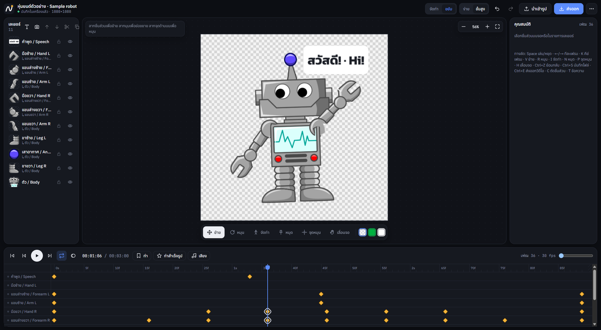

# TST Motion

**โปรแกรมทำอนิเมชันตัวละคร 2D แบบตัดชิ้นส่วน ฟรีและเปิดโค้ด ใช้ภาษาไทยได้**
**A free, open-source 2D cut-out animation app for Windows, in Thai and English.**



คุณเป็นคนขยับงานเอง AI ช่วยแค่ตัดชิ้นส่วน ไม่สร้างภาพและไม่ขยับแทน และไม่ต้องใช้ AI เลยก็ได้ เพราะมีเครื่องมือตัดด้วยมือครบ
AI ทั้งหมดทำงานในเครื่องคุณ ไม่ส่งรูปไปที่ไหน ไม่ต้องสมัครสมาชิก และไม่มีลายน้ำ

*You animate by hand. AI only helps cut a drawing into parts: it never draws or moves anything for you, and you can skip it, since manual cut tools are included. Any AI runs on your own computer. No account, no upload, no watermark.*

## ดาวน์โหลด / Download

ไปที่หน้า [Releases](../../releases/latest) แล้วดาวน์โหลดไฟล์ที่ลงท้ายด้วย `_x64-setup.exe` แล้วดับเบิลคลิกเพื่อติดตั้ง
(Windows 10/11, 64 บิต) จะมีไอคอนบนเดสก์ท็อปให้

ตัวติดตั้งยังไม่มีลายเซ็นดิจิทัล Windows อาจเตือน "Windows protected your PC" ให้กด **More info → Run anyway**

*Get the installer from [Releases](../../releases/latest) (Windows 10/11, 64-bit). It is not code-signed yet, so Windows may warn; click **More info → Run anyway**.*

## ทำอะไรได้บ้าง / Features

- **นำเข้ารูป** PNG JPG WebP GIF SVG PSD (แยกเลเยอร์ PSD ให้) รูปใหญ่ได้ถึง 16000 พิกเซลต่อด้าน
- **ตัดชิ้นส่วน** ไม้กายสิทธิ์ บ่วงบาศ แปรง ลบพื้นหลัง แตะเลือกด้วย AI และแยกหัว แขน ขาอัตโนมัติ
  (ทั้งคนและสัตว์/สิ่งของ) ได้ชิ้นที่มีจุดหมุนตรงข้อต่อ
- **ขยับ** คีย์เฟรม ไทม์ไลน์ เส้นความเร็ว ข้อต่อแม่-ลูก จัดท่าแบบ IK ข้อต่อนุ่ม หมุดดัดรูป หันหน้าแบบ 3D
  ผม/ผ้าพลิ้วเอง สลับภาพตา/ปาก ท่าสำเร็จรูป เส้นทางเคลื่อนที่ เห็นเฟรมข้างเคียง
- **ข้อความ เสียง กล้อง** ฟอนต์ไทยในตัว พิมพ์ทีละตัว ปากขยับตามเสียง กล้องซูม/เลื่อน/สั่น มาสก์ เอฟเฟกต์
- **ส่งออก** MP4 (พื้นเขียว/สีที่เลือก) WebM พื้นใส MOV พื้นใส GIF ภาพ PNG ทีละเฟรม สูงสุด 4K
- บันทึกอัตโนมัติ ประวัติเวอร์ชัน ไฟล์สำรอง อัดภาพการทำงานแบบไทม์แลปส์ คู่มือตอนเปิดครั้งแรก และงานตัวอย่าง

*Import many image formats (layered PSD too); cut with manual tools, AI tap-select or automatic head/arm/leg parts;
keyframes, bones with IK, soft joints, pin warp, 3D head turn, auto sway, image swap, quick motions, motion paths;
Thai fonts, typewriter text, loudness lip sync, camera, masks, effects; export MP4, transparent WebM/MOV, GIF and
PNG sequences up to 4K; autosave, version history, backups and timelapse recording.*

## สร้างจากโค้ด / Build from source

ต้องมี [Node.js](https://nodejs.org/) 20+ และ [Rust](https://rustup.rs/) พร้อม [ของที่ Tauri ต้องใช้บน Windows](https://tauri.app/start/prerequisites/)

```bash
npm install
npm run tauri dev      # เปิดแบบพัฒนา / run in development
npm test               # ทดสอบ / tests
npm run tauri build    # สร้างตัวติดตั้ง / build the installer
```

สร้างด้วย Tauri 2, Vite, Preact และ WebGL2 รายละเอียดแผนงานและข้อจำกัดที่รู้แล้วอยู่ใน [docs/PLAN.md](docs/PLAN.md)

*Built with Tauri 2, Vite, Preact and WebGL2. Plans and known limits: [docs/PLAN.md](docs/PLAN.md).*

## สนับสนุน / Support

ถ้าโปรแกรมนี้มีประโยชน์ เลี้ยงกาแฟผู้พัฒนาได้ที่ [buymeacoffee.com/xxxzas12p](https://buymeacoffee.com/xxxzas12p)

## สัญญาอนุญาต / License

โค้ดของ TST Motion ใช้สัญญาอนุญาต [GNU GPL v3.0 หรือใหม่กว่า](LICENSE): ใช้ ศึกษา แก้ไข และแจกต่อได้ฟรี
แต่ถ้าแจกฉบับที่แก้ไข ต้องเปิดโค้ดด้วยสัญญาเดียวกัน

*TST Motion is licensed under the [GNU GPL v3.0 or later](LICENSE).*

ส่วนที่มาจากผู้อื่น / Third-party parts:

- หุ่นยนต์ตัวอย่าง: "Cartoon Robot" จาก Wikimedia Commons, CC0 (ดู `public/sample/CREDITS.txt`)
- ฟอนต์ Sarabun, Kanit, Prompt, Mitr, Noto Sans Thai, Anuphan, JetBrains Mono: SIL Open Font License (ผ่าน Fontsource)
- โมเดล AI ที่ดาวน์โหลดเมื่อใช้งานครั้งแรก: SlimSAM (`Xenova/slimsam-77-uniform`, Apache-2.0)
  และ ViTPose (`onnx-community/vitpose-base-simple`, Apache-2.0) จาก Hugging Face
- ไลบรารี: Tauri, Preact, onnxruntime-web, mediabunny, ag-psd และอื่นๆ ตามสัญญาของแต่ละตัว (ดู `package.json`, `src-tauri/Cargo.toml`)
